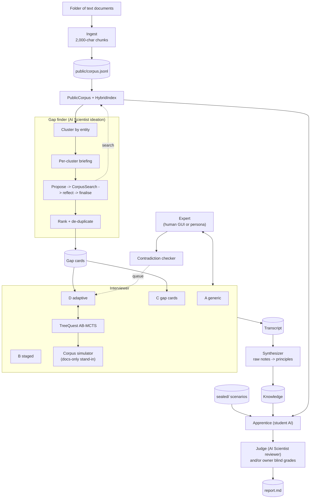

# kcap: expert knowledge-capture toolkit

kcap reads an organisation's documents, finds where they are silent about expert judgment, interviews an expert with targeted questions, turns the answers into reusable knowledge, and measures whether that knowledge helps a newcomer make better decisions.

It is both a **tool** and an **experimental harness**. Every component can be swapped and compared under controlled, pre-registered conditions. It builds on two open-source projects from Sakana AI:

- **[AI Scientist v2](https://github.com/SakanaAI/AI-Scientist-v2)**: its ideation loop is adapted into the *gap finder*, and its reviewer into the *judge*.
- **[TreeQuest](https://github.com/SakanaAI/treequest)** (AB-MCTS): drives the adaptive interviewer (*Strategy D*).

---

## Contents

1. [Folder structure](#1-folder-structure)
2. [How it works (data flow)](#2-how-it-works-data-flow)
3. [Data models](#3-data-models-kcapschemaspy)
4. [Modules in detail](#4-modules-in-detail)
5. [Experiments](#5-experiments)
6. [Configuration](#6-configuration)
7. [Command reference](#7-command-reference)
8. [Outputs](#8-outputs)
9. [Design rules and safeguards](#9-design-rules-and-safeguards)
10. [Tests](#10-tests)
11. [Installation](#11-installation)
12. [Preparing your own documents](#12-preparing-your-own-documents)
13. [Known limitations](#13-known-limitations)
14. [Licences](#14-licences)

---

## 1. Folder structure

```
kcap-public/
├── pyproject.toml              # package definition; installs the `kcap` command
├── .gitignore                  # ignores runs/, sealed/, config/prereg.yaml, caches
├── .gitmodules                 # AI-Scientist-v2 submodule
├── config/
│   ├── default.yaml            # every tunable parameter (models, budgets, strategies, experiments)
│   ├── prereg.example.yaml     # template for pre-registered pass thresholds
│   └── judge_examples/         # few-shot examples for the judge rubrics
│       ├── gap_card_match.json
│       ├── rule_match.json
│       └── scenario_answer.json
├── kcap/                       # the Python package
│   ├── cli.py                  # `kcap` command line (Typer)
│   ├── config.py               # loads default.yaml (+ optional override) and prereg.yaml
│   ├── io.py                   # paths, JSON/JSONL helpers, path guard for sealed/ and private/
│   ├── schemas.py              # pydantic data models
│   ├── llm/
│   │   ├── client.py           # provider-agnostic LLM client: roles, disk cache, cost log, budget cap
│   │   └── copilot_backend.py  # GitHub Copilot SDK backend
│   ├── retrieval/
│   │   └── index.py            # HybridIndex: BM25 (+ optional sentence embeddings)
│   ├── components/             # the knowledge-capture tool itself
│   │   ├── corpus.py           # PublicCorpus: the only way components see documents
│   │   ├── gap_common.py       # clustering, per-cluster briefing, ranking + de-duplication
│   │   ├── gap_miner.py        # gap finder built on the AI Scientist ideation loop
│   │   ├── gap_miner_simple.py # single-pass baseline gap finder (for comparison)
│   │   ├── contradiction.py    # finds document/answer conflicts and queues follow-ups
│   │   ├── synthesizer.py      # transcript -> raw notes -> reusable principles
│   │   └── interviewer/
│   │       ├── base.py                  # Interviewer interface + run_interview loop
│   │       ├── strategy_a_generic.py    # A: generic exit-interview questions
│   │       ├── strategy_b_staged.py     # B: staged basics -> workflow -> details
│   │       ├── strategy_c_hypothesis.py # C: gap-card hypotheses + fixed follow-ups
│   │       ├── strategy_d_adaptive.py   # D: AB-MCTS picks each next question
│   │       └── corpus_simulator.py      # documents-only stand-in expert used by D
│   ├── sakana_adapters/        # the ONLY modules that touch Sakana code
│   │   ├── ideation_adapter.py # adapted AI Scientist ideation (propose -> search -> reflect -> finalise)
│   │   ├── review_adapter.py   # adapted AI Scientist reviewer (rubric, ensemble, reflection)
│   │   └── treequest_adapter.py# thin wrapper around TreeQuest AB-MCTS
│   ├── eval/
│   │   ├── apprentice.py       # "student AI" answering scenarios with docs +/- captured knowledge
│   │   ├── grader.py           # grades scenario answers against references (via review_adapter)
│   │   ├── rule_matcher.py     # matches captured knowledge / gap cards to hidden rules
│   │   ├── metrics.py          # recall per facet, precision, coverage, curves, catch rate
│   │   ├── stats.py            # paired bootstrap confidence intervals
│   │   ├── judge_validation.py # human vs. LLM judge agreement, Cohen's kappa
│   │   └── report.py           # Experiment 1 report tables and charts
│   ├── human/                  # owner-facing tools
│   │   ├── gui.py              # browser GUI: blinded interviews, tagging, blind grading, sealing
│   │   ├── interview_cli.py    # terminal interview sessions
│   │   ├── tag_units_cli.py    # terminal tagging of captured knowledge
│   │   ├── blind_grade_cli.py  # terminal blind grading
│   │   ├── scenarios_cli.py    # write + seal scenarios; hash into prereg.yaml
│   │   └── term.py             # terminal input helpers (+ optional voice input)
│   ├── persona/                # LLM-simulated experts (know the hidden truth; evaluation only)
│   │   ├── synthetic_persona.py
│   │   └── oss_persona.py
│   ├── synth/                  # Experiment 1 synthetic world generation
│   │   ├── domain_gen.py       # domain description
│   │   ├── rulebook_gen.py     # hidden expert rules
│   │   ├── corpus_gen.py       # documents that leave traces of the rules (+ noise, contradictions)
│   │   ├── leak_check.py       # verifies rules are not stated outright in documents
│   │   ├── scenario_gen.py     # test scenarios with reference answers
│   │   └── world.py            # world folder layout (public/ vs private/)
│   ├── oss/                    # Experiment 2 open-source ground truth pipeline
│   │   ├── fetch.py            # download docs + PR review comments via GitHub API
│   │   ├── rule_extract.py     # extract candidate rules from reviews, check against docs
│   │   └── verify_cli.py       # human verification by reading quoted evidence
│   └── runners/                # experiment orchestration
│       ├── common.py           # build interviewers, token accounting
│       ├── exp1.py             # synthetic expert experiment
│       ├── exp2.py             # open-source ground truth experiment
│       └── exp3.py             # owner-as-expert experiment
├── tests/                      # pytest suite (fake LLM; no network needed)
├── third_party/
│   └── AI-Scientist-v2/        # git submodule, pinned; never modified
└── runs/                       # all outputs (git-ignored except .gitkeep)
```

Created at runtime and git-ignored:

| Path | Contents |
|---|---|
| `runs/.cache/` | Every LLM response, keyed by model + prompt + params + seed |
| `runs/cost_log.jsonl` | One line per uncached LLM call (role, task, model, tokens, USD) |
| `runs/exp1/`, `runs/oss/`, `runs/exp3/` | Per-experiment artefacts (see [Outputs](#8-outputs)) |
| `sealed/` | Hidden test scenarios. Components cannot read this folder |
| `config/prereg.yaml` | Your pre-registered thresholds, copied from the example |

---

## 2. How it works (data flow)



1. **Ingest:** your documents become a list of `Document` chunks.
2. **Gap finder:** groups related chunks and proposes *gap cards*, i.e. hypotheses about decisions the documents do not explain. Each card cites evidence and comes with an opening question.
3. **Interviewer:** asks the expert questions using one of four strategies. Strategy D searches over candidate questions with AB-MCTS, scoring each one against a stand-in expert that only knows the documents.
4. **Synthesizer:** turns the transcript into raw notes, then distils them into reusable *principles* (situation type, rule of thumb, why, exceptions, past examples).
5. **Evaluation:** a student AI answers hidden scenarios with the documents only and with the documents plus the captured knowledge. A judge (or the expert, blind) grades the answers. Pre-registered thresholds decide PASS/FAIL.

---

## 3. Data models (`kcap/schemas.py`)

| Model | Key fields | Produced by → used by |
|---|---|---|
| `Document` | `id`, `doc_type`, `date`, `text`, `related_rule_ids` (stripped before components see it) | ingest / world generation → everything |
| `Domain` | name, description, entities | Exp 1 world generation |
| `HiddenRule` | `id`, `condition`/`trigger`, `action`, `reason`, `scope`, `importance` | Exp 1 rulebook / Exp 2 verification → grading only |
| `GapCard` | `id`, `hypothesis`, `evidence_doc_ids`, `importance`, `undocumentedness`, `opening_question`, `cluster`; `priority = importance × undocumentedness` | gap finder → interviewers C/D |
| `Turn` | `idx`, `strategy`, `question`, `answer`, `question_kind`, `gap_card_id`, `answer_seconds`, `search_cost_tokens`, `meta` | interviewer → transcript |
| `KnowledgeUnit` | `id`, `condition`, `action`, `reason`, `scope`, `examples`, `source_turns`, `source_docs`, `confidence` | synthesizer → tagging, apprentice |
| `Scenario` | `id`, `prompt`, `reference_answer` (optional), `topic`, `arm`, `rule_ids` | scenario generation → apprentice, grading |
| `ContradictionItem` | `id`, `claim`, `doc_ids`, `question`, `source` | contradiction checker → interviewers C+K / D |

A `KnowledgeUnit` holds both raw notes and distilled principles. For a principle, `condition` is the situation type, `action` is the principle, `reason` is *why*, `scope` holds the exceptions and warning signs, and `examples` are past decisions.

---

## 4. Modules in detail

### 4.1 Core: `config.py`, `io.py`

- `load_config(path)` loads `config/default.yaml`, optionally merged with an override file. `load_prereg()` loads `config/prereg.yaml` if it exists.
- `io.py` defines `ROOT` (overridable with `KCAP_ROOT`), `RUNS`, `SEALED` and `CONFIG_DIR`, plus JSON/JSONL helpers.
  - `read_jsonl` splits on `\n` only, so Unicode line separators inside text are safe.
  - `public_path()` refuses paths under `sealed/` or `private/`.

### 4.2 LLM client: `kcap/llm/`

- Every call names a **role** (`interviewer`, `simulator`, `generator`, `persona`, `judge`, `apprentice`) and a **task** label. The role decides the provider, model and temperature.
- **Disk cache.** Responses are cached by (model, messages, params, seed). Re-runs are free and deterministic, and an interrupted run resumes from the cache.
- **Cost log.** Every uncached call is appended to `runs/cost_log.jsonl`.
- **Budget.** `budget.max_usd` and `budget.max_calls` are hard caps per process.
- **JSON helper.** `llm.json(...)` asks for JSON and parses it robustly.
- **Backends:** GitHub Copilot SDK (`copilot_backend.py`, bare chat sessions with no tools or memory), OpenAI, Azure OpenAI and Anthropic, all configured in `default.yaml`.
- **Corporate TLS proxies:** `truststore` is injected so HTTPS uses the OS certificate store.

### 4.3 Retrieval: `kcap/retrieval/index.py`

`HybridIndex` provides BM25 keyword search, optionally blended with sentence-transformer embeddings (`retrieval.embeddings`, `bm25_weight`). It also supplies a text-similarity score used for de-duplication.

### 4.4 Corpus: `components/corpus.py`

`PublicCorpus` is the **only** way components see documents. It strips ground-truth fields, loads through the path guard, builds the index, and offers:
- `search(query, k)`
- `render(docs, max_chars)`: a formatted block for prompts
- `sops()`: documents whose `doc_type` is `sop`, treated as official procedures
- `by_id`, `description`

### 4.5 Gap finder: `components/gap_miner.py` + `gap_common.py` + `sakana_adapters/ideation_adapter.py`

| Stage | Function | What happens | Config |
|---|---|---|---|
| 1. Cluster | `gap_common.cluster_corpus` | LLM assigns each chunk (batches of 30, first 250 chars) to a main entity, reusing known names. Clusters smaller than the minimum go to `misc` | `min_cluster_size` |
| 2. Briefing | `gap_common.workshop_file` | Markdown briefing per cluster: name, corpus description, up to 25 documents, any procedures, the task. Replaces AI Scientist's "workshop description" | n/a |
| 3. Ideate | `ideation_adapter.generate_temp_free_gap_cards` | Per hypothesis, up to `num_reflections + 1` rounds in one conversation. The LLM answers `ACTION: CorpusSearch \| FinalizeGapCard` + JSON `ARGUMENTS`. It must search before it may finalise, and invented document IDs are removed. An archive of earlier cards forces new ideas | `generations_per_cluster`, `num_reflections` |
| 4. Rank | `gap_common.finalize` | Sort by `priority`. Drop near-duplicates (similar hypothesis or identical evidence). Keep the top `top_k` as `G01…` | `top_k`, `dedup_threshold(_lexical)` |

**What is adapted from AI Scientist:**

| AI Scientist | kcap |
|---|---|
| Workshop description | Per-cluster briefing |
| Semantic Scholar novelty search | `CorpusSearch`: "is this already written down?" |
| `FinalizeIdea` | `FinalizeGapCard` |

`gap_miner_simple.py` is a single-prompt baseline used to measure what the ideation loop adds.

### 4.6 Interviewers: `components/interviewer/`

All strategies implement `next_question(turns, n) -> Turn` and optionally `observe(turns)`. `base.run_interview` runs the loop: ask, record the answer and answer time, then observe. It asks exactly `n` questions, or stops when a human expert's **own answering time** reaches the session limit. The interviewer's thinking time is not counted.

| Strategy | Class | Behaviour |
|---|---|---|
| **A** generic | `GenericInterviewer` | Fixed generic exit-interview questions |
| **B** staged | `StagedInterviewer` | Plans basics → workflow → details questions from a corpus summary. Optional `focus` areas (topic labels) |
| **C** hypothesis | `HypothesisInterviewer` | Asks each gap card's opening question in priority order, then fixed follow-ups (*why*, *exceptions*). Skips the follow-ups if the expert rejects the hypothesis |
| **C+K** | `HypothesisInterviewer(checker=…)` | C plus queued contradiction questions |
| **D** adaptive | `AdaptiveInterviewer` | See below |
| **C+S** | `AdaptiveInterviewer(checker=None)` | D without contradictions (ablation) |

**Strategy D (AB-MCTS).** Each turn it builds the available actions:
- `widen`: open an unexplored gap card
- `deepen`: follow up on the last answer
- `contradict`: ask about a queued conflict

TreeQuest runs `strategy_d.search_steps` steps. In each step AB-MCTS either generates a new candidate (`parent=None`) or refines an existing one (`_refine`), choosing by Thompson sampling. Each candidate is answered by the `CorpusSimulator` and rated by an LLM, which gives a score:

```
score = 0.5 · novelty + 0.3 · specificity + 0.2 · gap-card priority
```

The highest-scoring candidate is asked. Search tokens are logged per turn.

**`CorpusSimulator`** plays an employee who only knows the 5 most relevant documents. It must not import `synth/` or `persona/`, which is enforced by a test.

### 4.7 Contradiction checker: `components/contradiction.py`

- **Before the interview:** scans the documents for conflicting statements.
- **After each answer:** compares the answer with the retrieved documents.

Conflicts become `ContradictionItem`s with a ready-made follow-up question.

### 4.8 Synthesizer: `components/synthesizer.py`

| Function | Output |
|---|---|
| `synthesize(llm, turns, corpus)` | Raw notes. Each answer is turned into condition/action/reason/scope notes, duplicates are merged, and each note is checked against the documents (`confirmed_by_records` / `conflicts_with_records` / `stated`) |
| `distill(llm, turns, description)` | Reusable principles. Reads the whole interview and abstracts past decisions into situation type → principle → why → exceptions/signals → past examples, citing source turns. It is told not to restate past actions as instructions |
| `build_kb(kus, cfg)` | Search index over knowledge units |

### 4.9 Sakana adapters: `kcap/sakana_adapters/`

| File | Wraps | Notes |
|---|---|---|
| `ideation_adapter.py` | AI Scientist v2 `perform_ideation_temp_free.py` | Keeps the ACTION/ARGUMENTS protocol, the archive, the reflection prompt and the parsing. Never executes generated code |
| `review_adapter.py` | AI Scientist v2 `perform_llm_review.py` | Rubrics: `scenario_answer`, `rule_match`, `gap_card_match`. Ensemble of N judgments with majority vote (categorical) or mean (scores), then reflection rounds with an "I am done" early stop. Few-shot examples come from `config/judge_examples/` |
| `treequest_adapter.py` | `treequest` | `search(generate_fns, steps, algo="ABMCTSA", k=1)` returns the top-k states |

### 4.10 Evaluation: `kcap/eval/`

| File | Purpose |
|---|---|
| `apprentice.py` | Student AI. Answers a scenario using the top 6 documents and, optionally, the top 6 matching knowledge units |
| `grader.py` | Grades an answer 0/1/2 against the reference (review adapter) |
| `rule_matcher.py` | For each hidden rule, decides whether the knowledge units captured its action, reason and scope. Also matches gap cards to rules |
| `metrics.py` | Rule recall (any facet / full), facet recall, gap-card precision and coverage, recall curves, contradiction catch rate |
| `stats.py` | Paired bootstrap confidence intervals |
| `judge_validation.py` | Agreement and Cohen's kappa between a human and the LLM judge |
| `report.py` | Experiment 1 report (tables + matplotlib charts) |

### 4.11 Human tooling: `kcap/human/`

`gui.py` serves a local web app (`kcap exp3 gui`, default `http://127.0.0.1:8765`):

| Page | Purpose |
|---|---|
| `/` | **Blinded interview sessions.** Shows only "Session 1/2/3" in a random order, never the strategy. Has a question box, an answer field (Ctrl+Enter sends), *I don't know*, *End session*, and a timer of the expert's own time. A burden rating (1–5) and note are collected at the end. Each session runs in a background thread |
| `/notes` | Distilled principles per interview, with the source Q&A. The expert tags each one: *true?*, *already documented?*, *would have written it unprompted?*, *importance 1–5*. Every click saves. *Surprise* = true, undocumented and not unprompted |
| `/grade` | **Blind grading** of student-AI answers. The situation and answer are shown in shuffled order with the condition hidden. Scores 0/1/2; every click saves |
| `/seal` | Optional form for writing and sealing your own scenarios |

**Security:**
- binds to 127.0.0.1 only
- POST requests are accepted only from the same origin
- request bodies are size-capped
- the browser receives opaque keys, never strategy letters, and never sees sealed scenario text before grading

Terminal equivalents:
- `interview_cli.py`
- `tag_units_cli.py`
- `blind_grade_cli.py`
- `scenarios_cli.py`
- `term.py`: multi-line input and optional Whisper voice input

### 4.12 Personas: `kcap/persona/`

Simulated experts used only for evaluation in Experiments 1 and 2. They know the hidden rules and follow disclosure behaviour (`persona.misremember_prob`, `persona.volunteer_prob`). Disclosures are logged so recall can also be measured from the expert's side.

### 4.13 Synthetic worlds: `kcap/synth/` (Experiment 1)

1. `domain_gen` creates a domain.
2. `rulebook_gen` creates the hidden rules, including a minimum number of scope/exception rules.
3. `corpus_gen` writes documents that leave *traces* of the rules, plus noise, SOPs and planted contradictions.
4. `leak_check` regenerates documents that state a rule outright.
5. `scenario_gen` writes test scenarios with reference answers.

`world.py` lays out `public/` (visible to components) and `private/` (ground truth, guarded).

### 4.14 Open-source ground truth: `kcap/oss/` (Experiment 2)

1. `fetch.py` downloads a repository's docs and merged-PR review comments (GitHub API, cached).
2. `rule_extract.py` extracts candidate "we always / never do X because Y" rules from maintainer comments. It keeps only those the documentation does not state, and pre-checks whether each is general.
3. `verify_cli.py` asks a human two reading questions per rule, using the quoted evidence only, so no project knowledge is needed. `--auto` uses the LLM instead (weaker evidence).

### 4.15 Runners: `kcap/runners/`

- `common.py`: `build_interviewer(strategy, …)` and token accounting (interview / search / synthesis).
- `exp1.py`, `exp2.py`, `exp3.py`: orchestration, described in the next section.

---

## 5. Experiments

| # | Expert | Ground truth | Main question |
|---|---|---|---|
| 1 | LLM persona | Generated hidden rulebook | Does an adaptive, hypothesis-driven interviewer recover more hidden rules per question? |
| 2 | (gap finder only; persona optional) | Rules maintainers enforce in PR reviews but the docs don't state | Does the gap finder find real undocumented rules? |
| 3 | A real person | Hidden scenarios + the expert's own blind grading and tags | Does it draw out useful tacit knowledge from a real person? |

### Experiment 3 workflow (owner as expert)

```text
kcap exp3 ingest <folder> --description "..."   # build the corpus
kcap exp3 split                                  # gap mining + random topic split into arms B/C/D
kcap exp3 gen-scenarios-balanced --per-arm 7     # hidden scenarios from topic labels only, sealed unseen
git add config/prereg.yaml && git commit         # pre-register thresholds + scenario hash
kcap exp3 gui                                    # 3 blinded interview sessions in the browser
kcap exp3 synthesize                             # raw notes + distilled principles per arm
#   -> tag principles at /notes
kcap exp3 apprentice                             # student AI answers each scenario twice
#   -> blind-grade at /grade
kcap exp3 report                                 # runs/exp3/report.md
```

**Fairness mechanisms:**
- topics are split randomly across arms
- topic labels are neutral (they name the area without revealing the hypothesis)
- interviewer identity is hidden from the expert
- scenarios are generated without access to transcripts or hypotheses, then sealed and hashed before any session
- only the expert's own answering time counts toward the session limit
- answers are graded blind and shuffled
- thresholds are pre-registered, and deviations are recorded in `prereg.yaml`

---

## 6. Configuration

`config/default.yaml` (override with `--config my.yaml`):

| Section | Keys | Meaning |
|---|---|---|
| `providers` | `copilot`, `openai`, `azure`, `anthropic` | Connection settings; API keys are read from environment variables |
| `roles` | per role: `provider`, `model`, `temperature`, `max_tokens` | Use a different model family for `persona`/`judge` than for `interviewer` |
| `pricing` | model → [input, output] USD per million tokens | Used for the cost log |
| `budget` | `max_usd`, `max_calls` | Hard caps per process |
| `seed` | int | Global seed |
| `retrieval` | `embeddings`, `embedding_model`, `bm25_weight` | Retrieval mode |
| `gap_miner` | `top_k`, `generations_per_cluster`, `num_reflections`, `dedup_threshold`, `dedup_threshold_lexical`, `min_cluster_size` | Gap finder |
| `persona` | `misremember_prob`, `volunteer_prob` | Simulated expert behaviour |
| `strategy_c` | `followups_per_card` | Follow-ups per card |
| `strategy_d` | `search_steps`, `weights` (`novelty`, `specificity`, `priority`) | AB-MCTS budget and reward |
| `judge` | `ensemble`, `num_reflections` | Reviewer settings |
| `exp1` | domains, seeds, rules, documents, noise, contradictions, scenarios, question budget, budget curve, strategies | Experiment 1 |
| `exp2` | `repo`, `max_review_pages`, `sample_to_verify`, `min_verified_rules` | Experiment 2 |
| `exp3` | `session_minutes`, `d_search_steps`, `n_scenarios` | Experiment 3 (live D search is smaller because each step costs several LLM calls) |

`config/prereg.example.yaml`: copy it to `config/prereg.yaml`, set your thresholds, and commit it **before** running. Sealing scenarios writes their SHA-256 hash here.

---

## 7. Command reference

| Command | Purpose |
|---|---|
| `kcap check` | One tiny call per role to verify credentials and caching |
| `kcap models` | List models available through the Copilot SDK |
| **Experiment 1** | |
| `kcap exp1 generate --domains 5 --seeds 5` | Generate synthetic worlds |
| `kcap exp1 import-pilot <dir>` | Import a hand-built pilot world |
| `kcap exp1 chat-persona --world <id>` | Chat with a persona yourself |
| `kcap exp1 run --strategies A,B,C,D --n 40` | Interview every world with each strategy, evaluate, report |
| `kcap exp1 evaluate` / `report` | Re-evaluate from cached transcripts / rebuild the report |
| `kcap exp1 budget-curve <world>` | Recall versus question budget |
| `kcap judge export` / `score <labels.csv>` | Hand-label judge outputs and compute agreement |
| **Experiment 2** | |
| `kcap exp2 fetch OWNER/REPO` | Download docs and PR review comments |
| `kcap exp2 extract OWNER/REPO` | Candidate rules absent from the docs |
| `kcap exp2 verify OWNER/REPO [--auto]` | Human (or LLM) verification |
| `kcap exp2 run OWNER/REPO [--with-persona]` | Gap-finder precision/recall (+ optional interviews) |
| **Experiment 3** | |
| `kcap exp3 ingest <folder> --description` | Build the corpus |
| `kcap exp3 split` / `resplit` | Gap mining + arm assignment / re-assign without mining |
| `kcap exp3 seal` / `gen-scenarios` / `gen-scenarios-balanced` | Owner-written / random hidden / per-arm hidden scenarios |
| `kcap exp3 gui [--port]` | Browser GUI |
| `kcap exp3 interview --arm B\|C\|D` | Terminal interview (not blinded) |
| `kcap exp3 synthesize` | Notes and principles |
| `kcap exp3 tag` / `grade` | Terminal tagging / blind grading |
| `kcap exp3 apprentice` | Student AI answers |
| `kcap exp3 report` | Pre-registered checks and per-arm table |

---

## 8. Outputs

### Experiment 3 (`runs/exp3/`)

| File | Contents |
|---|---|
| `public/corpus.jsonl`, `public/domain.json` | Ingested corpus and description |
| `gap_miner/clusters.json`, `gap_miner/workshops/NN.md`, `gap_miner/ideation_log.json` | Clusters, the exact briefings and the ideation trace |
| `split.json` | Gap cards, neutral topic labels, arm per card, blinded session order |
| `sessions/<arm>.jsonl` | Transcript turns with answer times and search metadata |
| `sessions/burden_<arm>.json`, `sessions/search_log_<arm>.json` | Burden rating and D's per-turn search log |
| `notes_<arm>.json` | Raw notes |
| `kus_<arm>.json` | Distilled principles (used for tagging and the apprentice) |
| `tags.json` | Expert tags per principle |
| `apprentice.json` | Student answers per scenario × condition |
| `owner_grades.json` | Blind grades |
| `report.md` | Final report |

### Experiments 1 and 2

- `runs/exp1/worlds/<world>/{public,private}/` and `runs/exp1/<run_id>/`: transcripts, knowledge units, grades, metrics, charts, report.
- `runs/oss/<owner>__<repo>/{public,private,results}/`: corpus, reviews, candidate and verified rules, gap cards, results, report.

---

## 9. Design rules and safeguards

| Rule | Enforcement |
|---|---|
| No ground-truth leakage to the interviewer, gap finder, checker, synthesizer or simulator | `PublicCorpus` + path guard; `test_boundaries.py` |
| The simulator never sees the truth | `corpus_simulator.py` may not import `synth/` or `persona/` (test) |
| Sakana code is isolated | Only `sakana_adapters/` imports `treequest` or AI Scientist; the submodule stays unmodified (test) |
| Equal question budget | `run_interview` asks exactly `n` questions or stops at the human time limit; offline search is logged as cost |
| Separate model roles | Persona and judge configurable to a different family from the interviewer |
| Reproducibility | Seeds, LLM cache, config hash per run, JSON/JSONL artefacts |
| Pre-registration | `prereg.yaml` committed before results; deviations recorded with reasons |
| Blinding (Exp 3) | GUI hides the strategy and condition; shuffled grading; neutral labels |

---

## 10. Tests

```bash
python -m pytest -q tests
```

The suite uses a fake LLM, so it needs no network or API keys.

| File | Covers |
|---|---|
| `test_boundaries.py` | Leakage guards, import boundaries, Sakana isolation |
| `test_components.py` | Gap finder, interviewers, simulator, contradiction checker, synthesizer, TreeQuest wiring, budget cap |
| `test_metrics.py` | Metrics, disclosure log, catch rate, gap-card precision, bootstrap, kappa |
| `test_sakana_adapters.py` | Ideation adapter (offline, schema) and review adapter (aggregation) |
| `test_end_to_end.py` | Exp 3 dry run for arms B/C/D; Exp 1 end-to-end if a pilot world is present (`KCAP_PILOT_DIR`) |

---

## 11. Installation

```bash
git clone --recurse-submodules <this repo>
cd kcap-public
python -m venv .venv && . .venv/bin/activate      # Windows: .venv\Scripts\Activate.ps1
pip install -e ".[dev]"                           # add ",embeddings" for semantic retrieval
cp config/prereg.example.yaml config/prereg.yaml  # set thresholds, then commit
kcap models                                       # check model IDs (Copilot)
kcap check                                        # one tiny call per role
```

- **LLM access:** GitHub Copilot via `gh auth login` or `GH_TOKEN`, or set `provider: openai|azure|anthropic` per role and export the matching API key.
- **Model names:** edit `roles` in `config/default.yaml` to models you can access.
- **Data location:** set `KCAP_ROOT` to keep `runs/` and `sealed/` somewhere else.

---

## 12. Preparing your own documents

- Put plain-text documents in one folder. Supported: `.md .txt .rst .csv .log .eml .json`. Other formats (code, images, `.docx`) are skipped, so convert them first.
- The **parent folder name becomes `doc_type`**. Put official procedures and standards in a folder named `sop/` so the gap finder treats them as "what is officially written".
- Files are split into 2,000-character chunks. The file name is prefixed to each chunk.
- Write a 2–3 sentence `--description`. It is injected into almost every prompt.
- Only include documents you are allowed to send to your configured LLM provider.

---

## 13. Known limitations

- The gap finder works bottom-up on document clusters and proposes isolated hypotheses. It has no model of principles versus details.
- Strategy D's reward targets undocumented *facts* (novelty, specificity) on a documents-only simulated answer, not the quality of reusable *principles*. "Deeper" in the tree refines one question's wording rather than planning a thread across turns.
- Live latency: about 3 LLM calls per search node. Each search step is sequential.
- Scenarios generated from the documents tend to favour what the documents already cover, which leaves little room to show captured judgment.

---

## 14. Licences

- `third_party/AI-Scientist-v2` is distributed under its own *AI Scientist Source Code License*. Check its terms before commercial use. kcap's adapters are derived from it and are marked as such in their headers.
- `treequest` is Apache 2.0.
