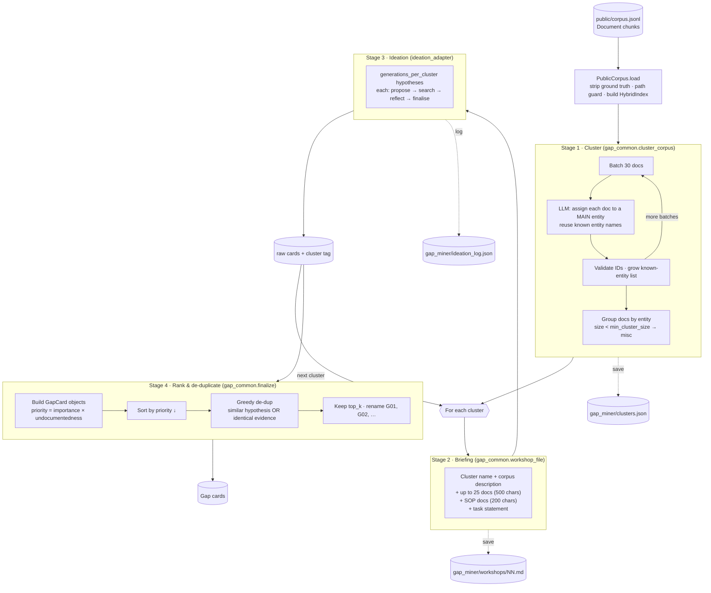
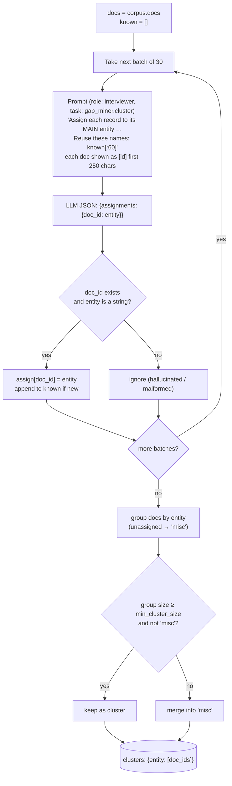
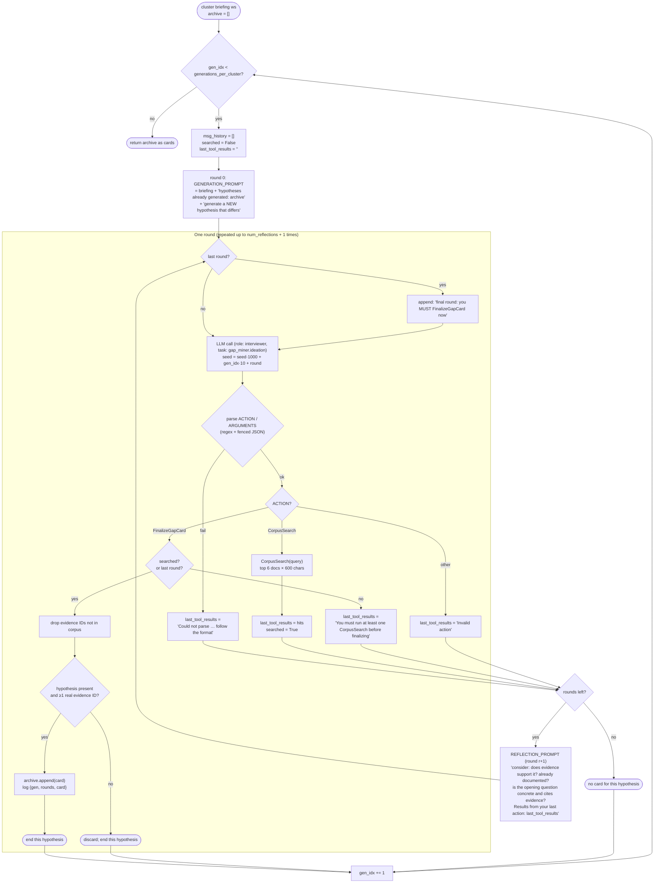
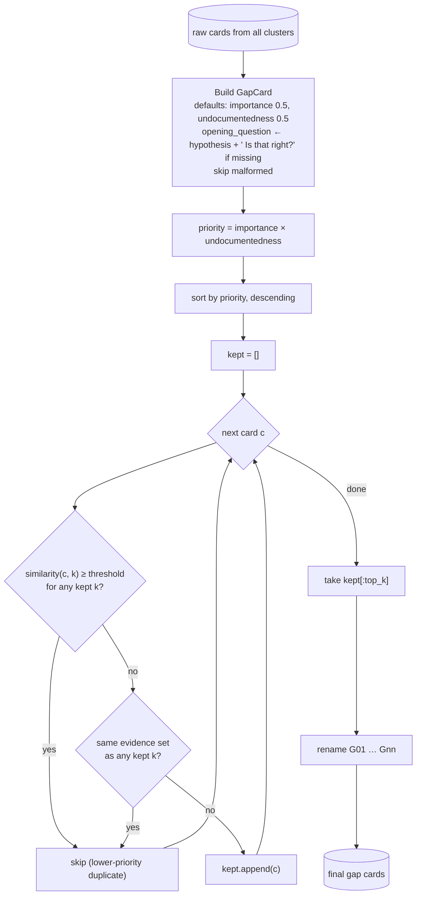
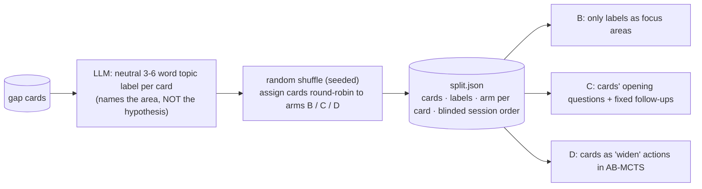
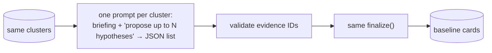

# Gap finder: detailed design and flow

The gap finder reads a document corpus and proposes **gap cards**. A gap card is a hypothesis about a decision or practice that experts follow but no document explains. Each card cites the documents that show the behaviour and carries an opening question to ask the expert. Gap cards are the agenda for interviewer strategies C and D.

It adapts the **idea-generation loop of [Sakana AI Scientist v2](https://github.com/SakanaAI/AI-Scientist-v2)** (`perform_ideation_temp_free.py`): propose an idea, check novelty with a search tool, reflect, finalise. Here, "novel" means *not already written down in the corpus*.

| File | Role |
|---|---|
| `kcap/components/gap_miner.py` | Orchestrator (`mine`) |
| `kcap/components/gap_common.py` | Clustering (`cluster_corpus`), briefing (`workshop_file`), ranking and de-duplication (`finalize`) |
| `kcap/sakana_adapters/ideation_adapter.py` | Adapted AI Scientist loop (`generate_temp_free_gap_cards`, `CorpusSearch`, `FinalizeGapCard`, prompts, parser) |
| `kcap/components/gap_miner_simple.py` | Single-prompt baseline (`mine_simple`) for comparison |
| `kcap/components/corpus.py`, `kcap/retrieval/index.py` | Corpus access, hybrid BM25 search, similarity for de-duplication |

---

## 1. End-to-end overview



---

## 2. Stage 1: clustering

**Why:** an undocumented practice shows up as a *pattern across related documents*, for example several specs that all make the same unexplained choice. Clustering puts related documents in front of the LLM together.



| Detail | Value |
|---|---|
| Batch size | 30 documents per call |
| Text shown per document | first 250 characters |
| Known-name hint | up to 60 previous entity names, so synonyms merge |
| Minimum cluster size | `gap_miner.min_cluster_size` (default 3) |
| Calls | ⌈N / 30⌉ |
| Seed | batch offset (deterministic, cached) |

---

## 3. Stage 2: the briefing ("workshop file")

AI Scientist conditions idea generation on a *workshop call for papers*. kcap replaces that with a per-cluster briefing:

```text
# Cluster: <entity>

## Organization
<corpus description supplied at ingest>

## Records about this entity (<total> total, showing ≤25)
[<id> | <doc_type> | <date>]
<first 500 characters>
…

## Official procedures that may apply (SOPs)
- [<id>] <first 200 characters>     (documents whose doc_type == "sop"; "(none)" otherwise)

## Task
Find decisions, priorities or judgments in these documents that deviate from procedures or from what a
newcomer would do, and whose reasons no document explains. Cite document IDs.
```

Every briefing is saved to `gap_miner/workshops/NN.md`, so you can audit exactly what the LLM saw.

---

## 4. Stage 3: the ideation loop (AI Scientist, adapted)

### 4.1 Protocol

The LLM runs as an agent in one continuous conversation per hypothesis. Each reply must follow this format:

```text
ACTION:
CorpusSearch | FinalizeGapCard

ARGUMENTS:
{"query": "..."}                                  # for CorpusSearch
{"gap_card": {"hypothesis": "...",                # for FinalizeGapCard
              "evidence_doc_ids": ["..."],
              "importance": 0.0-1.0,
              "undocumentedness": 0.0-1.0,
              "opening_question": "..."}}
```

| Tool | Replaces (AI Scientist) | What it does |
|---|---|---|
| `CorpusSearch` | `SearchSemanticScholar` | Hybrid search over the local corpus (top 6, 600 chars each). Used both to find supporting evidence **and** to check whether the practice is already written down. No network |
| `FinalizeGapCard` | `FinalizeIdea` | Emits the gap card fields |

**System prompt (summary).** You are an analyst looking for decisions no document explains. Propose hypotheses about undocumented expert knowledge: repeated choices, priorities, exclusions or judgments that deviate from procedures or newcomer expectations. Ground each in specific documents, prefer recurring patterns a successor would get wrong, and don't propose things already stated. Search at least once before finalising.

### 4.2 Detailed flow for one cluster



**Robustness**
- Any exception inside one hypothesis is caught and logged, and the loop continues with the next.
- Malformed replies cost one round but never crash the run.
- Every call is cached by seed, so re-running is free and deterministic.

### 4.3 What each mechanism contributes

| Mechanism | Effect on card quality |
|---|---|
| Archive of earlier cards in the prompt | Diversity: each new hypothesis must differ from earlier ones in the cluster |
| Forced search before finalising | The LLM must look for the rule in the documents instead of guessing that it is undocumented |
| Reflection with search results | Self-falsification: drop hypotheses the evidence does not support or that are already written |
| Evidence-ID validation | Removes hallucinated citations; cards with no real evidence are discarded |
| Final-round force | Bounds cost per hypothesis to `num_reflections + 1` calls |
| `opening_question` field | Turns the hypothesis into a correction question for the expert ("In H012 and H045 you did X when Y, unlike the procedure. Why?") |

### 4.4 Example trace (illustrative)

```text
user  (round 0)  # Cluster: Rooftop units … Hypotheses already generated: (none) … generate a new hypothesis
asst             ACTION: CorpusSearch  ARGUMENTS: {"query": "capacitor replaced on every rooftop unit visit"}
tool             [H0107] … swapped capacitor although it tested fine …  [H0115] … replaced capacitor preventively …
user  (round 1)  Round 2/4. Consider whether the evidence supports it, whether it is documented …  Results: …
asst             ACTION: FinalizeGapCard  ARGUMENTS: {"gap_card": {"hypothesis": "When servicing rooftop units older than
                 ~8 years, technicians replace the run capacitor even if it tests fine (likely to avoid summer call-backs)",
                 "evidence_doc_ids": ["H0107","H0115","H9999"], "importance": 0.8, "undocumentedness": 0.7,
                 "opening_question": "In H0107 and H0115 the capacitor was replaced although it tested fine. When do you
                 do that, and why?"}}
code             searched = True → allowed;  H9999 not in corpus → removed;  2 real IDs → archived (priority 0.56)
```

---

## 5. Stage 4: ranking and de-duplication



| Setting | Default | Note |
|---|---|---|
| `top_k` | 40 | Cards kept |
| `dedup_threshold` | 0.6 | Cosine similarity, used when `retrieval.embeddings: true` |
| `dedup_threshold_lexical` | 0.4 | Token overlap, used otherwise |

Because the list is sorted first, a duplicate pair always keeps the higher-priority card.

---

## 6. After mining: experiment use (Experiment 3)



Neutral labels let a human expert, or a labels-only interviewer, work on the same topics without seeing the AI's hypotheses.

---

## 7. Baseline: `gap_miner_simple`



There are no tools, no reflection and no archive. Comparing the two (Experiment 2: precision and recall against verified rules) measures what the AI Scientist loop adds.

---

## 8. Parameters, cost and outputs

| Parameter (`config/default.yaml → gap_miner`) | Default | Effect |
|---|---|---|
| `min_cluster_size` | 3 | Smaller clusters are merged into `misc` |
| `generations_per_cluster` | 4 | Hypotheses attempted per cluster |
| `num_reflections` | 3 | Extra rounds per hypothesis (total rounds = 4) |
| `top_k` | 40 | Final cards |
| `dedup_threshold` / `dedup_threshold_lexical` | 0.6 / 0.4 | De-duplication strictness |

**LLM calls (upper bound):**

$$
\lceil N_{docs}/30 \rceil \;+\; N_{clusters} \times \text{generations\_per\_cluster} \times (\text{num\_reflections}+1)
$$

For example, 200 chunks in 10 clusters gives 7 + 10 × 4 × 4 = **167** calls at most. In practice there are fewer, because many hypotheses finalise in round 2.

| Output (under the experiment folder) | Contents |
|---|---|
| `gap_miner/clusters.json` | entity → document IDs |
| `gap_miner/workshops/NN.md` | Exact briefing per cluster |
| `gap_miner/ideation_log.json` | Every accepted card with its generation index and number of rounds used |
| `split.json` (Exp 3) or `results/gap_cards*.json` (Exp 2) | Final cards |

---

## 9. Known limitations and directions

- **Flat, bottom-up view.** Clusters are groups of documents, not a model of *principles → policies → decisions → details*. Cards are therefore isolated "undocumented practice" hypotheses, and interviews tend to collect isolated facts rather than reusable principles.
- **Self-assessed scores.** `importance` and `undocumentedness` are the LLM's own estimates. They are only checked later by the expert or by ground truth.
- **Procedure-centric task wording.** The briefing contrasts behaviour with procedures (`sop` documents). Corpora without procedures fall back to "what a newcomer would do".
- **Direction under consideration:** first build a knowledge tree from the corpus (goal → principles → policies → decisions → evidence), then type gaps by their position in the tree (missing principle, missing reason, missing boundary, orphan principle, contradiction). That makes each question explicitly target a principle, a reason, a boundary or an example.
