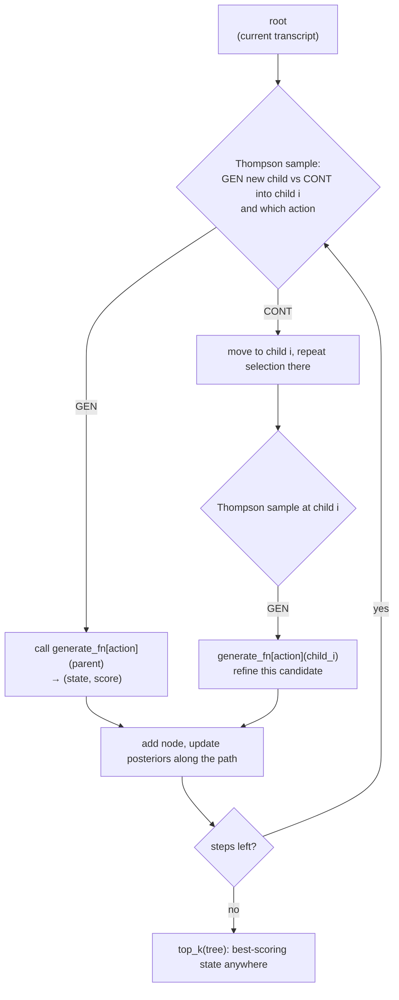
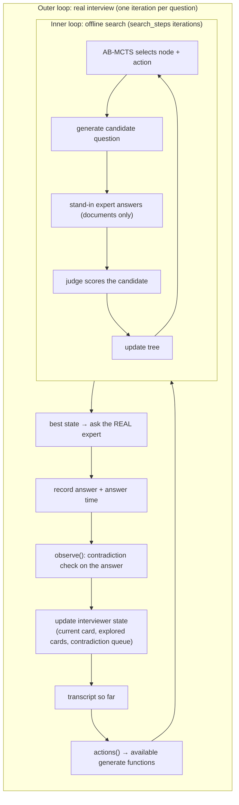
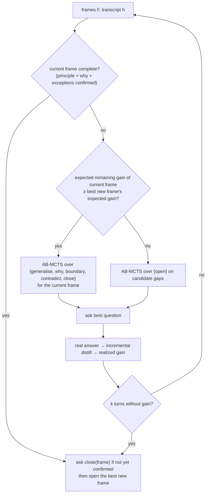
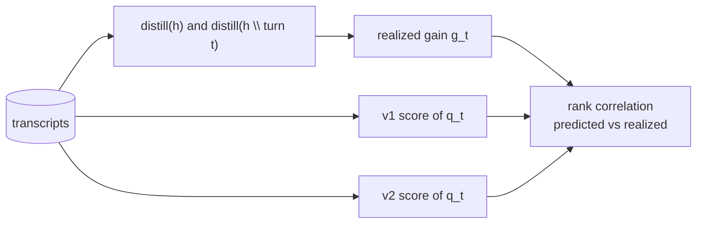

# Tree search for interviewing (Strategy D): algorithm and reward design

Strategy D chooses each interview question with **AB-MCTS** (Adaptive Branching Monte Carlo Tree Search) from Sakana AI's [TreeQuest](https://github.com/SakanaAI/treequest). This document covers four things: how the algorithm works, how kcap wires it into an interview, what the current reward optimises, and how the reward should be designed for interviews that aim at **reusable expert principles**.

| File | Role |
|---|---|
| `kcap/sakana_adapters/treequest_adapter.py` | The only module that imports `treequest`; runs the search |
| `kcap/components/interviewer/strategy_d_adaptive.py` | Actions, candidate generation, refinement, scoring, turn loop |
| `kcap/components/interviewer/corpus_simulator.py` | Documents-only stand-in expert used to score candidates |
| `kcap/components/contradiction.py` | Supplies `contradict` actions |
| `config/default.yaml` → `strategy_d`, `exp3.d_search_steps` | Search budget and reward weights |

---

## 1. Why tree search for an interview?

An interview is a **sequential decision problem under a tight budget**. Every question costs expert time, and the space of possible questions is effectively unbounded. At each turn the interviewer must choose between:

- **going wider**: opening a new topic, or
- **going deeper**: following up on, or sharpening, something promising.

That is exactly the trade-off AB-MCTS was designed for. The catch is that AB-MCTS needs a **score** for each candidate, and in an interview the true score (the expert's answer) is expensive and only available once per turn. So kcap runs the search **offline, against a stand-in expert**, and asks the real expert only the winning question. Everything therefore depends on the reward.

---

## 2. AB-MCTS in brief

Standard MCTS uses a fixed set of children per node. Repeated sampling ("best of N") generates many answers but never refines any of them. AB-MCTS combines both ideas: at every node it decides, adaptively, whether to

- **GEN**: generate a *new* child from this node (go wider), or
- **CONT**: descend into an *existing* child and continue from it (go deeper).

The decision uses **Thompson sampling** over a Bayesian model of the scores observed so far:

- Each option (generate new, or each existing child) has a posterior over "the score I would get if I chose this".
- Draw one sample from each posterior and pick the option with the highest draw.
- Options that scored well are chosen more often (exploitation). Options with few observations have wide posteriors and still get chosen sometimes (exploration).

With several generation actions (here: `widen`, `deepen`, `contradict`), the algorithm also chooses *which action* to expand. The variant used by kcap, `ABMCTSA` (node *aggregation*), keeps the per-action posteriors as part of this decision.



Original setting (Inoue et al., NeurIPS 2025): coding and engineering tasks with **cheap, reliable external feedback** (e.g. unit tests), where trying many candidates is affordable. Interviews break both assumptions, which is why the reward design (Section 5 onward) matters so much.

---

## 3. How kcap wires AB-MCTS into an interview

### 3.1 Two loops



- **Inner loop:** `treequest_adapter.search(fns, steps)` creates `tq.ABMCTSA()`, calls `algorithm.step(tree, generate_fns)` `steps` times, and returns `tq.top_k(tree, algorithm, k=1)`.
- **Outer loop:** `run_interview` handles one real question per iteration. The search is rebuilt from scratch every turn.

### 3.2 Actions (generate functions)

Each generate function has the TreeQuest signature `parent_state | None → (state, score ∈ [0,1])`. A `None` parent means GEN from the root (a fresh candidate). A parent means refine that candidate.

| Action | Available when | GEN (parent = None) | Refine (parent of same kind) |
|---|---|---|---|
| `widen` | an unexplored gap card exists | pick one of the 3 highest-priority unexplored cards at random; use its `opening_question` | rewrite the parent question via `_refine` |
| `deepen` | at least one answer exists | LLM writes one follow-up on the last answer (reason, exception, what-if, how they notice), told not to repeat what was answered | `_refine` |
| `contradict` | the contradiction queue is non-empty | pick one of the 3 oldest queued items; use its question | `_refine` |

**`_refine`** shows the LLM the parent question **and the stand-in's simulated answer to it**, and asks for a version that would reveal "more specific, undocumented knowledge (conditions, numbers, exceptions)". If the parent is a different kind of action, the base question is used unchanged.

### 3.3 A node's state

```text
{
  "candidate_question": "...",
  "kind": "widen" | "deepen" | "contradiction",
  "gap_card_id": "G07" | null,
  "contradiction_id": "X03" | null,
  "simulated_answer": "...",      # stand-in expert's reply (stored for refinement)
  "novelty": 0.0-1.0,
  "specificity": 0.0-1.0,
  "rationale": "..."
}
```

### 3.4 After the search

The best state is asked. Then:
- `widen`: the card becomes the *current topic* and is marked explored.
- `contradiction`: the item is removed from the queue.

The search log for each turn records the chosen kind, score, node count, available actions and search tokens.

### 3.5 Cost

Each node costs roughly **3 LLM calls** (generate or refine, simulate, score). With 16 steps that is about 48 calls per real question. At 7–25 s per call that came to about 10 minutes per question in practice, so live human sessions use `exp3.d_search_steps: 4`. The expert's waiting time is excluded from their session time.

---

## 4. The current reward (v1)

```python
sim  = CorpusSimulator.answer(question)            # documents-only stand-in
nov, spec = judge(question, sim, transcript)       # LLM ratings in [0,1]
score = 0.5 * nov + 0.3 * spec + 0.2 * min(1, card.priority)   # priority = 0.6 for contradictions
```

| Term | Judge prompt (summary) | Intended meaning |
|---|---|---|
| novelty | "Would the real answer likely contain knowledge NOT already in the records or the interview so far?" | Ask where documents are silent |
| specificity | "Would it be concrete (conditions, numbers, exceptions)?" | Prefer precise, checkable answers |
| priority | gap card's importance × undocumentedness | Focus on important gaps |

### 4.1 Where v1 came from

v1 was designed for **Experiment 1**, where the ground truth is a hidden rulebook of concrete rules ("when X, do Y, because Z, except W") and success means *rule recall*. Novelty and specificity are good proxies for "this question will surface a hidden concrete rule".

### 4.2 What v1 actually optimises in a real interview

| Observation | Cause in the reward |
|---|---|
| Captured items restate *what was done* in specific past cases | `specificity` rewards concreteness, not abstraction |
| Questions repeat what was already answered | No redundancy penalty (the transcript is only shown to the judge) |
| Questions use internal codes or lack context | No clarity term |
| Many "I don't know" answers on some topics | No answerability term |
| Slow: few questions per session | ~3 calls per node, sequential |
| "Deeper" never follows a thread across turns | Depth in the tree = rewording one question within one turn; the outer loop is greedy |

### 4.3 Structural limits beyond the formula

1. **Weak oracle.** The stand-in only knows documents. It can show that documents are silent (novelty), but not that the expert holds a principle there.
2. **One-turn horizon.** The tree is discarded after every question. Nothing plans "case → criterion → reason → boundary" across turns.
3. **Proxy of a proxy.** An LLM's guess about a simulated answer is far from the real target (useful knowledge for a successor), which invites reward over-optimisation.

---

## 5. What the reward should measure

### 5.1 The ideal objective

Let $K$ be the captured knowledge (a set of principles), $h$ the transcript, and $\mathcal{S}$ the situations a successor will face. Define the value of the knowledge as

$$
V(K) = \mathbb{E}_{s \sim \mathcal{S}}\big[\text{quality of a newcomer's decision on } s \text{ given documents} + K\big].
$$

The ideal reward for a candidate question $q$ is its expected value of information, net of the expert's cost:

$$
r^*(q \mid h) = \mathbb{E}_{a \sim P_\text{expert}(a\mid q,h)}\Big[V\big(K \cup \text{distill}(h,a)\big) - V(K)\Big] - \lambda\,c(q).
$$

This is the Bayesian-experimental-design view (cf. BED-LLM, Uncertainty of Thoughts). Two parts are unavailable during an interview:

- $P_\text{expert}$, the expert's answer distribution, which is the whole point of asking;
- $V$, which needs held-out situations; using the test set inside the search would leak it.

So the reward needs a **computable proxy for $V$** and an **honest proxy for $P_\text{expert}$**.

### 5.2 Proxy for V: principle quality

A captured item helps future decisions when it is:

| Criterion | Check |
|---|---|
| **General** | applies to a class of situations, not one past case |
| **Decisive** | states a criterion, priority or trade-off that changes what one would do |
| **Justified** | has a reason (goal, constraint, past failure) |
| **Bounded** | states exceptions and warning signs |
| **Grounded** | backed by at least one concrete past decision |
| **Novel** | not already stated in the documents |
| **Non-redundant** | not a paraphrase of something already captured |

These map directly onto the principle format produced by `synthesizer.distill` (situation type, principle, why, exceptions, examples) and onto the expert's tags (true, documented, unprompted, importance). The structure mirrors the **Critical Decision Method** for expert elicitation: anchor on a real case, then probe cues, goals, options and what would have changed the decision.

---

## 6. Proposed reward (v2)

### 6.1 State: principle frames

Extend the search state with a set of **principle frames** $F$, each partially filled:

```text
frame = { situation: empty|draft|confirmed,
          principle: empty|draft|confirmed,
          why:       empty|draft|confirmed,
          exceptions: empty|draft|confirmed,
          examples:  [ ... ] }
```

### 6.2 Actions aligned with frame slots

| Action | Purpose | Example |
|---|---|---|
| `open(frame)` | Anchor on a case or gap card; create a frame | "Tell me about a time when …" |
| `generalise(frame)` | Fill *situation* and *principle* | "What would you do if it were a different project or customer?" |
| `why(frame)` | Fill *why* | "What goal or constraint drives that choice?" |
| `boundary(frame)` | Fill *exceptions* | "When would you NOT do this? What would change your mind?" |
| `contradict(frame)` | Resolve a document/answer conflict | "Document X says …, but you said … Which applies when?" |
| `close(frame)` | Confirm the principle in one sentence | "So the rule is …, right, or is it different?" |

"Going deep" now means **completing a frame across several real turns**, not rewording one question.

### 6.3 Score of a candidate question

$$
R(q) = \underbrace{\mathbb{E}_{a \sim \tilde P(a\mid q,h)}\big[\Delta\mathrm{PQ}(F,a)\big]}_{\text{expected principle gain}} \times \underbrace{p_\text{ans}(q)}_{\text{answerability}} - \mu\,\mathrm{red}(q,h) - \nu\,\mathrm{unclear}(q)
$$

| Term | Computation | Addresses |
|---|---|---|
| $\Delta\mathrm{PQ}(F,a)$ | Judge rates which frame slots answer $a$ would fill and how general, decisive and novel the resulting principle would be. Weighted by slot importance: principle 0.35, why 0.25, exceptions 0.25, example 0.15 | the target quantity |
| $\tilde P(a\mid q,h)$ | Sample 2–3 diverse plausible answers, conditioned on documents **and the expert's previous answers** | documents-only oracle |
| $p_\text{ans}(q)$ | Prior from document coverage of the topic, updated online from the expert's "I don't know" rate per topic | wasted turns |
| $\mathrm{red}(q,h)$ | Max similarity of $q$ to past questions, and of the expected answer to existing principles | repeated questions |
| $\mathrm{unclear}(q)$ | Judge: does the question rely on internal codes or missing context? | hard-to-understand questions |

Initial weights: $\mu = 0.3$, $\nu = 0.2$. Fit them later (Section 7).

**Novelty is kept, but moved:** it multiplies the *principle* (is the rule or its reason undocumented?) rather than raw facts. A documented fact with an undocumented *reason* or *boundary* is still valuable.

### 6.4 Planning across turns



- AB-MCTS stays **inside** a turn and picks among candidate questions.
- A light **outer policy over frames** decides whether to stay on the current thread or open a new one. This is a stopping rule like the reward propagation in Uncertainty of Thoughts.
- A frame is done when its principle, *why* and *exceptions* are confirmed, or after $k = 3$ turns without gain.

---

## 7. Calibration: making the reward trustworthy

AB-MCTS optimises whatever it is given. An uncalibrated, LLM-judged proxy invites over-optimisation and inherits judge biases (verbosity, position, self-preference; rubric wording effects).

| Layer | Signal | Use |
|---|---|---|
| **Online** (each turn) | Realized $\Delta\mathrm{PQ}$ from the real answer (incremental `distill`) vs. the predicted $R(q)$ | Update per-action and per-topic priors; shrink scores of actions that over-promise. The node score acts as a process reward; the real answer is the outcome reward |
| **Offline** (after sessions) | Expert tags per principle: true, documented, unprompted, importance 1–5 | Fit slot weights and penalties so predicted quality ranks true, undocumented, important principles highest |
| **Judge hygiene** | Different model family from the interviewer; ensemble of 3; spot checks against the expert | Reduce systematic bias |

### 7.1 Offline replay (no new sessions)

Existing transcripts are enough to compare reward versions:

1. For each real turn $t$, compute the **realized gain** $g_t$: distil the transcript with and without turn $t$ and score the difference.
2. Re-score the question actually asked at $t$ with v1 and with v2.
3. Report the rank correlation between predicted score and $g_t$, per interviewer.
4. Adopt v2 only if it predicts realized gain better than v1.



---

## 8. Cost and latency

| Item | v1 | v2 |
|---|---|---|
| Calls per node | generate/refine + simulate + score ≈ 3 | generate + 2 sampled answers + 1 batched judge ≈ 4 |
| Nodes per turn | 16 offline / 4 live | 4–6, scored in parallel with a cheaper model |
| Extra per real turn | contradiction check | + incremental distill (1 call) for realized gain |

Levers:
- Score candidates in parallel within a step.
- Use a smaller model for simulation and judging.
- Pre-compute candidates for the next turn while the expert is typing (everything up to the previous answer is known).
- Cache per-topic answerability.

---

## 9. Risks and mitigations

| Risk | Mitigation |
|---|---|
| Leading the witness (putting principles in the expert's mouth) | `close` is phrased as a check ("right, or different?"); expert's *true?* tag catches errors |
| Over-abstraction (wise-sounding but vague) | *decisive* and *grounded* criteria; require an example per principle |
| Reward hacking via long or elaborate questions | `unclear` and length penalties; judge ensemble; cross-family judge |
| Simulator over-confidence | condition $\tilde P$ on the real transcript; learn $p_\text{ans}$ from real "I don't know" answers |
| Test leakage | the reward never sees sealed scenarios; $V$ is proxied by principle quality only |
| Search cost outweighs benefit | track search tokens per captured principle; compare against Strategy C (no search) at equal expert time |

---

## 10. Configuration (current and proposed)

```yaml
strategy_d:
  search_steps: 16                 # offline / simulated-expert runs
  weights: {novelty: 0.5, specificity: 0.3, priority: 0.2}   # v1
  # proposed:
  # reward: principle_gain         # v1 | principle_gain
  # slot_weights: {principle: 0.35, why: 0.25, exceptions: 0.25, example: 0.15}
  # penalties: {redundancy: 0.3, unclear: 0.2}
  # answer_samples: 2
  # frame_stall_turns: 3
exp3:
  d_search_steps: 4                # live human sessions
```

---

## 11. Recommended path

1. Implement **offline replay** and measure how well v1 predicts realized principle gain.
2. Implement v2 behind `strategy_d.reward`, keeping v1 for comparability with earlier experiments.
3. Fit weights from expert tags; repeat the replay.
4. Run new live sessions (C vs. D-v2) at equal expert time, with thresholds pre-registered beforehand.

---

## References

1. Inoue, Misaki, Imajuku, Kuroki, Nakamura, Akiba. *Wider or Deeper? Scaling LLM Inference-Time Compute with Adaptive Branching Tree Search.* NeurIPS 2025. arXiv:2503.04412. Code: github.com/SakanaAI/treequest
2. Hu et al. *Uncertainty of Thoughts: Uncertainty-Aware Planning Enhances Information Seeking in LLMs.* NeurIPS 2024. arXiv:2402.03271
3. Choudhury et al. *BED-LLM: Intelligent Information Gathering with LLMs and Bayesian Experimental Design.* ICLR 2026. arXiv:2508.21184
4. Li, Tamkin, Goodman, Andreas. *Eliciting Human Preferences with Language Models (GATE).* arXiv:2310.11589
5. Andukuri, Fränken, Gerstenberg, Goodman. *STaR-GATE: Teaching Language Models to Ask Clarifying Questions.* arXiv:2403.19154
6. Li et al. *MediQ: Question-Asking LLMs and a Benchmark for Reliable Interactive Clinical Reasoning.* arXiv:2406.00922
7. Lightman et al. *Let's Verify Step by Step.* arXiv:2305.20050
8. Gao, Schulman, Hilton. *Scaling Laws for Reward Model Overoptimization.* ICML 2023. arXiv:2210.10760
9. Zheng et al. *Judging LLM-as-a-Judge with MT-Bench and Chatbot Arena.* arXiv:2306.05685
10. Klein, Calderwood, MacGregor. *Critical Decision Method for Eliciting Knowledge.* IEEE Trans. SMC, 1989.
